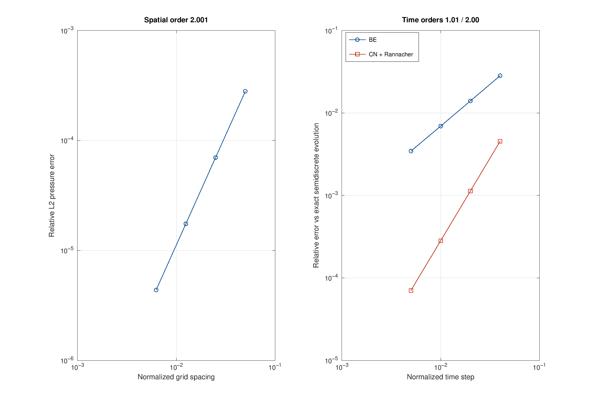
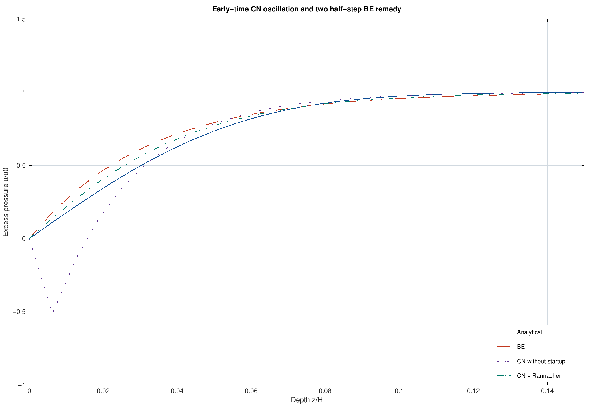

# 01 · Single-drainage Terzaghi consolidation

Verification of an own finite-difference solver against the analytical pressure and settlement of a saturated, laterally confined, elastic column. Depth $z$ increases downward from the drained top. The bottom is sealed. Gravity is removed by using excess pore pressure; grains and water are incompressible, with Biot coefficient one.

$$u_t=c_v u_{zz},\qquad u(0,t)=0,\quad u_z(H,t)=0,\quad u(z,0)=q\ (z>0).$$

$$M=\frac{E(1-\nu)}{(1+\nu)(1-2\nu)},\quad c_v=\frac{kM}{\mu},\quad T_v=\frac{c_vt}{H^2}.$$

| Quantity | Illustrative value | SI unit |
|---|---:|---|
| Height $H$ | 10 | m |
| Young's modulus $E$ | $10^7$ | Pa |
| Poisson ratio $\nu$ | 0.3 | 1 |
| Intrinsic permeability $k$ | $10^{-14}$ | m² |
| Dynamic viscosity $\mu$ | $10^{-3}$ | Pa s |
| Applied load $q=u_0$ | $10^5$ | Pa |

Thus $M=13.461538$ MPa, $c_v=1.34615385\times10^{-4}$ m²/s, $H^2/c_v=742857.14$ s (8.59788 days), and final downward settlement $s_\infty=qH/M=0.0742857$ m.

With $M_m=\pi(2m+1)/2$:

$$\frac{u}{u_0}=\sum_{m=0}^\infty\frac{2}{M_m}\sin(M_mz/H)e^{-M_m^2T_v},\qquad U=1-\sum_{m=0}^\infty\frac{2}{M_m^2}e^{-M_m^2T_v},\qquad s=Us_\infty.$$

`terzaghi_terms` doubles the term count until a geometric bound on the absolute normalized pressure tail is below the requested tolerance (default $10^{-10}$). This also bounds the degree series. The exact initial state is returned at time zero; the top value is zero, with an instantaneous spatial discontinuity. Extremely small positive times requiring more than 262144 terms fail explicitly.

The finite-difference operator uses central second differences and a mirrored ghost node at the impermeable bottom. Sparse LU solves the theta scheme, with backward Euler (BE) and Crank–Nicolson (CN). Numerical $U$ is the trapezoidal depth integral of pressure. The exact $U(0)=0$ is assigned separately because a point boundary jump has zero measure in the continuum but finite quadrature weight on a grid.

Measured from `run_01`:

| Check | Result | Acceptance |
|---|---:|---:|
| Spatial order, 20–160 intervals at $T_v=0.2$ | 2.000688 | 1.8–2.2 |
| Finest relative L2 pressure error | $4.370684\times10^{-6}$ | below 0.01 |
| BE temporal order | 1.012143 | 0.85–1.15 |
| CN with startup temporal order | 2.002764 | 1.8–2.2 |

Spatial refinement uses normalized $\Delta t=2\times10^{-5}$ and CN with two startup steps. Temporal refinement uses the **exact semidiscrete** evolution `expm(t*L)` on a fixed 160-interval mesh, isolating time error from spatial error. It is not a second continuum solution. Relative L2 norms are weighted by depth using `trapz`.

An abrupt drained boundary excites high spatial frequencies. CN is stable but does not strongly damp these modes: at the demonstrated first step its normalized minimum is approximately −0.514. Replacing each of the first two coarse steps with two BE half steps damps them (minimum zero in this run). Subsequent CN steps retain second-order temporal convergence. Stability alone does not guarantee positivity or a physically acceptable early profile.

Other outputs: [pressure](figures/pressure.png), [degree](figures/degree.png), [settlement](figures/settlement.png), and [CSV tables](results). From the root, `setup_paths; run_01(pwd)` regenerates this module.

**CODE_BRIGHT comparison: pending.** The [guide and importer contract](codebright/README.md) explain required genuine exports. Current plots compare only analytical and own FD solutions. Normalizing a compressible CODE_BRIGHT model by its own initial pressure does not remove changes in diffusivity or settlement; the constitutive assumptions must also match. No actual CODE_BRIGHT verification error is reported.

References: [Terzaghi, *Theoretical Soil Mechanics* (1943)](https://doi.org/10.1002/9780470172766); [Rannacher, *Finite element solution of diffusion problems with irregular data* (1984)](https://link.springer.com/article/10.1007/BF01390130); [official CODE_BRIGHT guide and tutorials](https://deca.upc.edu/en/projects/code_bright).
