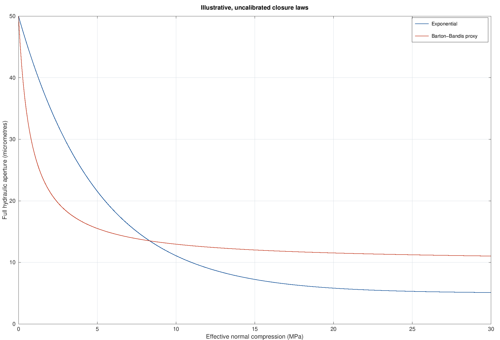

# 02 · Stress-dependent aperture and cubic-law flow

An illustrative constitutive calculation for a single fracture under **compression-positive** effective normal stress $\sigma_n'=\sigma_n-p$ (fracture pressure coefficient one). This is prescribed stress/pressure coupling, not a displacement or pressure PDE solver. Negative effective normal stresses are rejected: tensile opening needs a different model.

Two closure models are deliberately compared:

$$b_{\exp}=b_r+(b_0-b_r)e^{-\alpha\sigma_n'},\qquad \Delta V=\frac{\sigma_n' V_m}{K_{ni}V_m+\sigma_n'},\qquad b_{\rm BB}=b_0-\Delta V.$$

$$K_n=\frac{d\sigma_n'}{d\Delta V}=K_{ni}\left(1+\frac{\sigma_n'}{K_{ni}V_m}\right)^2.$$

| Quantity | Value | SI conversion |
|---|---:|---:|
| Zero-stress aperture $b_0$ | 50 μm | $50\times10^{-6}$ m |
| Exponential residual $b_r$ | 5 μm | $5\times10^{-6}$ m |
| Exponential coefficient $\alpha$ | 0.2 MPa⁻¹ | $0.2\times10^{-6}$ Pa⁻¹ |
| Maximum hyperbolic closure $V_m$ | 40 μm | $40\times10^{-6}$ m |
| Initial normal stiffness $K_{ni}$ | 20 GPa/m | $20\times10^9$ Pa/m |
| Fluid viscosity $\mu$ | 0.001 Pa s | same |
| Fracture width $w$ | 1 m | same |
| Imposed pressure gradient | −100 Pa/m | same |

Half the maximum hyperbolic closure occurs at $\sigma_n'=K_{ni}V_m=0.8$ MPa. The hyperbolic residual aperture is $b_0-V_m=10$ μm, different from the exponential model's 5 μm. Consequently this compares **two illustrative parameterizations**, not isolated functional-form differences under matched asymptotes.

For full **hydraulic aperture** $b$, smooth parallel-plate laminar flow gives

$$Q=-\frac{wb^3}{12\mu}\frac{dp}{dx},\qquad k_f=\frac{b^2}{12},\qquad T_h=\frac{\rho g b^3}{12\mu}.$$

Units matter: $Q$ is m³/s, $k_f$ is m², and hydraulic transmissivity $T_h$ is m²/s. The intermediate $b^3/12$ is a geometric flow capacity in **m³**, not a hydraulic transmissivity in m²/s. `cubic_law_flow` returns these distinct quantities. Density is 1000 kg/m³ and $g=9.81$ m/s². Plot labels explicitly distinguish capacity and hydraulic transmissivity.

The closure laws supply an aperture proxy used as hydraulic aperture. There is no separate roughness/contact calibration relating hydraulic and mechanical apertures. Real fractures can depart from this relation through tortuosity, contact, roughness, and inertial effects; cubic-law validity is an assumption, not established by these unit tests.

At fixed total normal stress 30 MPa, pressure increases from 10 to 28 MPa, reducing effective normal stress from 20 to 2 MPa. The computed final/initial flow and transmissivity ratios at fixed gradient are **220.089859** (exponential) and **6.405248** (hyperbolic). The cubic aperture dependence magnifies constitutive uncertainty. These values are synthetic predictions, not measurements or fitted properties of a rock sample.

The [stiffness](figures/stiffness.png), [hydraulic transmissivity](figures/transmissivity.png), and [CSV tables](results) are regenerated by `setup_paths; run_02(pwd)` from the root. Tests check limiting closure, monotonicity, stiffness against a finite-difference derivative, doubling aperture → eightfold discharge, a hand-computed discharge, zero gradient, reversed flow, and invalid inputs.

The model is a conceptual companion to laboratory-constrained fracture studies such as [Sciandra et al. (2025)](https://doi.org/10.1016/j.jrmge.2025.03.059), *Revealing hydro-mechanical properties of a natural fracture in low-permeable shale*. It does **not** reproduce that study's data or 3D model. [Rutqvist et al. (2002)](https://doi.org/10.1016/S1365-1609(02)00022-9) provides context for stress-dependent properties in coupled fractured-rock modeling; the present coefficients are uncalibrated.

Primary model references: [Bandis, Lumsden & Barton (1983), *Fundamentals of rock joint deformation*](https://doi.org/10.1016/0148-9062(83)90595-8); [Barton, Bandis & Bakhtar (1985), *Strength, deformation and conductivity coupling of rock joints*](https://doi.org/10.1016/0148-9062(85)93227-9); [Witherspoon et al. (1980), *Validity of cubic law for fluid flow in a deformable rock fracture*](https://doi.org/10.1029/WR016i006p01016).
