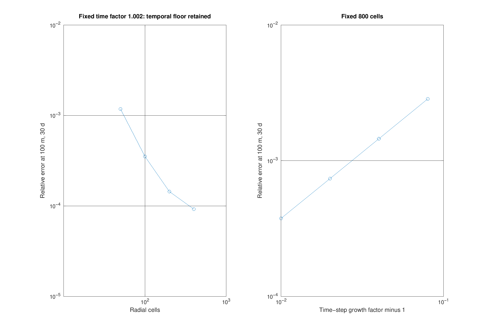

# 03 · Radial injection, conservation, and parameter recovery

A finite-volume solution of radial Darcy diffusion is verified against the infinite-domain Theis line-source solution. A Cooper–Jacob fit then recovers permeability and storage from the **numerical pressure history**, not from analytically generated fit data.

$$p_t=D\frac{1}{r}(rp_r)_r,\quad D=\frac{k}{\phi\mu c_t},\quad \Delta p=\frac{q\mu}{4\pi kh}E_1(u),\quad u=\frac{r^2\phi\mu c_t}{4kt}.$$

`expint` supplies $E_1$. Initial pressure rise is zero. Positive $q$ means injection (positive pressure rise); the forward solvers also support extraction. The inverse fit is restricted to positive injection.

| Parameter | Illustrative value | Unit |
|---|---:|---|
| Intrinsic permeability $k$ | $10^{-13}$ | m² |
| Porosity $\phi$ | 0.15 | 1 |
| Dynamic viscosity $\mu$ | $5\times10^{-4}$ | Pa s |
| Effective compressibility $c_t$ | $10^{-9}$ | Pa⁻¹ |
| Layer thickness $h$ | 50 | m |
| Injection rate $q$ | 0.01 | m³/s |
| Inner/outer radius | 0.1 / 40000 | m |
| Duration | 2592000 (30 days) | s |

Here the bulk storage coefficient is $\phi c_t$ [Pa⁻¹] by definition; it is not a dimensionless aquifer storativity. Diffusivity is **1.333333 m²/s**. The layer is homogeneous, isotropic, confined, saturated, isothermal, and constant-property; gravity and deformation-induced stress changes are absent.

The numerical grid has logarithmic edges and geometric cell centers. Ring storage capacities and exact steady radial conductances are

$$C_i=\phi c_t\pi h(r_{i+1/2}^2-r_{i-1/2}^2),\qquad G_{ij}=\frac{2\pi kh}{\mu\ln(r_j/r_i)}.$$

Backward Euler solves $(C/\Delta t+L)p^{n+1}=Cp^n/\Delta t+q e_1$. Every internal face appears with opposite signs in its two neighboring cells. The outer pressure is zero, and the inner boundary prescribes total inflow $q$. Outflow is integrated using the same implicit pressure as the update. Default: 600 cells, initial step 0.1 s, step growth factor 1.01.

Measured results:

| Check | Result | Acceptance |
|---|---:|---:|
| Maximum pointwise pressure error at 10, 100, 1000 m, only $u\leq0.1$ | 0.118091% | below 2% |
| Maximum volume-balance defect / total injected volume | $4.244\times10^{-12}$ | below 0.01 |
| Permeability recovery error | 0.209110% | below 2% |
| $\phi c_t$ recovery error | 0.944726% | below 2% |
| Final observation-pressure change after doubling outer radius | $3.176\times10^{-6}$ | below 0.001 |

The balance includes stored volume **plus cumulative outer outflow**. Relative pressure errors are omitted from near-zero early tails, where division by tiny exact pressure is misleading. This qualification is applied explicitly in the error CSV; it is not a claim of accuracy at every early time. Observation pressures use linear interpolation in log radius.

At 30 days, $\sqrt{4Dt}=3718.1$ m; the outer boundary is 10.758 diffusion lengths away, and its analytical pressure rise is approximately $3.70\times10^{-48}$ Pa. Doubling $R$ with a comparable log-grid spacing checks sensitivity. The numerical model has a **finite well radius** whereas Theis is a line source; agreement is assessed at radii much larger than the well and after the earliest transient.

Spatial refinement uses 50–400 cells with a fixed fine temporal factor 1.002; its error reaches a temporal/interpolation floor. It therefore does not claim a pure asymptotic second-order spatial rate. Temporal refinement uses 800 cells and factors 1.08–1.01, yielding approximately first-order behavior as expected for BE. Tables in [results](results) retain all values.

For late time $u\ll1$, $E_1(u)\simeq-\gamma-\ln u$. Fitting $p=a\log_{10}t+b$ (seconds) gives

$$A=a/\ln 10,\quad k=\frac{q\mu}{4\pi hA},\quad \phi c_t=\frac{4k}{r^2\mu}\exp(-\gamma-b/A).$$

The fit uses numerical data at 100 m, selecting $u<0.005$ using the **known synthetic input parameters**. This is a verification experiment, not blind field inference. `cooper_jacob_fit` itself receives no true permeability or storage. It estimates only their combination $\phi c_t$, not each separately. [Recovery CSV](results/parameter_recovery.csv) and [fit plot](figures/recovery.png) include the recovered values and fit interval.

Regenerate with `setup_paths; run_03(pwd)` from the root. Additional outputs: [radial profiles](figures/profiles.png), [qualified error histories](figures/error.png), and [mass balance](results/mass_balance.csv).

References: [Theis (1935), *The relation between the lowering of the piezometric surface and the rate and duration of discharge of a well using ground-water storage*](https://doi.org/10.1029/TR016i002p00519); [Cooper & Jacob (1946), *A generalized graphical method for evaluating formation constants and summarizing well-field history*](https://doi.org/10.1029/TR027i004p00526). No fault-stability prediction is made: pressure alone excludes poroelastic and thermal stress effects discussed by [Kivi et al. (2022)](https://www.nature.com/articles/s41598-022-06067-0).
