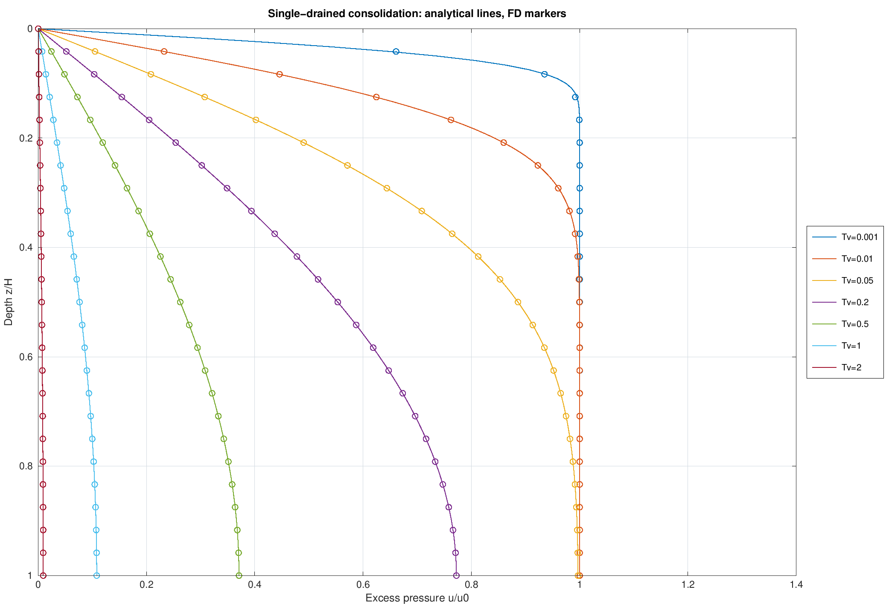
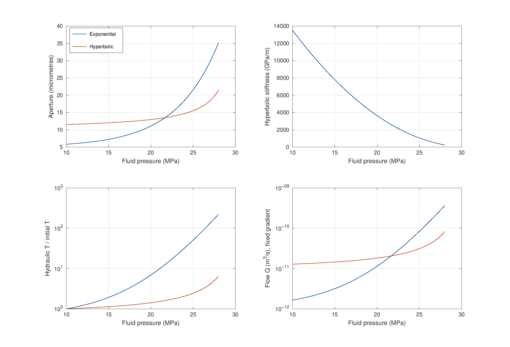
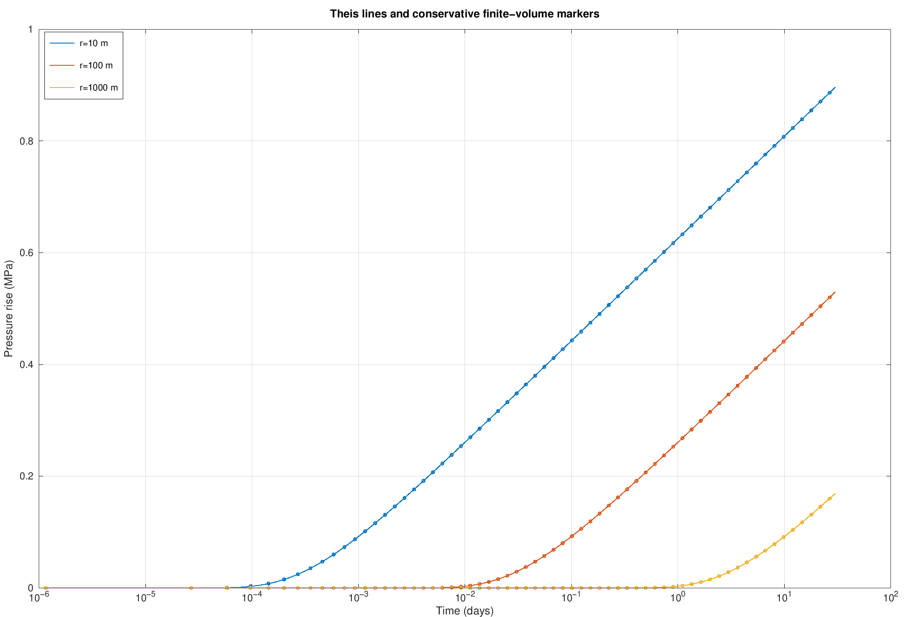
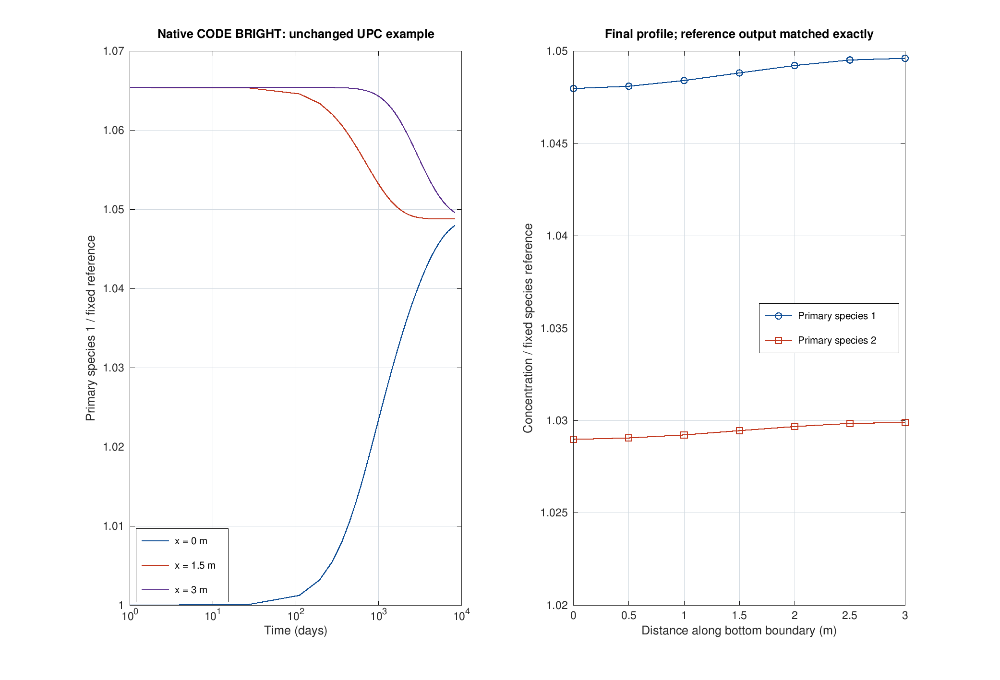

# codebright-verification

[](https://github.com/VahidKz/codebright-verification/actions/workflows/ci.yml)

Reproducible MATLAB/Octave benchmarks for consolidation, stress-dependent fracture flow, and radial injection, accompanied by a **completed native CODE_BRIGHT run**. Analytical solutions, independent numerical solvers, convergence studies, and parameter recovery make the assumptions and errors inspectable. By [Vahid Keshavarz](https://www.researchgate.net/profile/Vahid-Keshavarz-2).

**Native CODE_BRIGHT run completed:** the unchanged official equilibrium-chemistry example reached its final time in **2074 steps**, with exit code 0; the generated result file matches the distributed reference byte for byte. See the [run record, reproducible Windows command, and measured outputs](codebright_run/README.md). The separate [Terzaghi comparison in CODE_BRIGHT](01_terzaghi_consolidation/codebright/README.md) remains pending.

| Module | Verification | Measured result |
|---|---|---|
| [01 · Terzaghi consolidation](01_terzaghi_consolidation) | Fourier solution vs sparse finite differences; space/time refinement | Spatial order **2.001**; finest relative L2 error **0.000437%** |
| [02 · Fracture closure and flow](02_fracture_aperture_cubic_law) | Closure limits, stiffness derivative, cubic scaling | Illustrative injection gives **220.09× / 6.41×** flow gains for exponential / hyperbolic closure |
| [03 · Radial injection](03_radial_injection_theis) | Conservative finite volume vs Theis; Cooper–Jacob recovery from numerical data | Maximum qualified pressure error **0.118%**; permeability / storage recovery errors **0.209% / 0.945%** |
| [Native CODE_BRIGHT run](codebright_run) | Replay of UPC's equilibrium-chemistry example on Windows | **2074 steps; generated result SHA-256 matches reference** |

The independent-module values come from [committed CSV results](results/summary.csv), generated with GNU Octave 10.3.0; the [native metrics](codebright_run/results/metrics.csv) come from the recorded CODE_BRIGHT execution. The radial error includes only samples with Theis argument $u\leq0.1$, avoiding relative errors in near-zero early-time tails. The code asserts its acceptance criteria on every reproduction.






Run from the repository root in MATLAB or GNU Octave, with no toolboxes or external datasets:

```matlab
run_all_tests
run_all
```

Headless Octave:

```sh
octave --no-gui --quiet --eval "run_all_tests; run_all"
```

`run_all` regenerates the three independent modules' PNGs, CSVs, [summary metrics](results/summary.csv), and runtime record, plus the native-run figure from committed measurements. Native CODE_BRIGHT execution is reproduced separately using the [Windows runner](codebright_run/README.md). For a container installation:

```sh
docker run --rm --network none -e HOME=/tmp -v "$PWD:/work" -w /work \
  gnuoctave/octave:10.3.0 octave --no-gui --quiet --eval "run_all_tests; run_all"
```

Tested locally with **GNU Octave 10.3.0** on Linux, using gnuplot for headless PNGs. GitHub Actions independently installs Octave on `ubuntu-latest` and archives regenerated results. MATLAB compatibility is a design target; MATLAB execution has **not** been verified. The native run used **CODE_BRIGHT_2026_10** on Windows with **Intel OpenMP 2026.2.0**, through the command line with GiD-generated official inputs. GiD itself was not run.

The independent modules use **illustrative, uncalibrated** parameters and verify idealized equations against mathematical references. The native calculation replays the developers' existing chemical-equilibrium example; it adds no experimental validation or original reactive-transport implementation. The fracture module prescribes normal stress and fluid pressure. Fracture networks, propagation, shear, thermal effects, fully coupled poroelastic mechanics, and induced-seismicity prediction remain outside the independent models' scope. Module READMEs state discretization and constitutive limitations.

Equations, parameter units, numerical methods, and limitations are documented in each module README. [Cite this software](CITATION.cff) when reusing the implementation.

Primary references: [Terzaghi (1943)](https://doi.org/10.1002/9780470172766), [Bandis et al. (1983)](https://doi.org/10.1016/0148-9062(83)90595-8), [Witherspoon et al. (1980)](https://doi.org/10.1029/WR016i006p01016), [Theis (1935)](https://doi.org/10.1029/TR016i002p00519), [Cooper & Jacob (1946)](https://doi.org/10.1029/TR027i004p00526), and the [official CODE_BRIGHT documentation](https://deca.upc.edu/en/projects/code_bright). Additional context appears in each module.

Original implementation released under the [MIT license](LICENSE). No CODE_BRIGHT/GiD distribution files are included.
